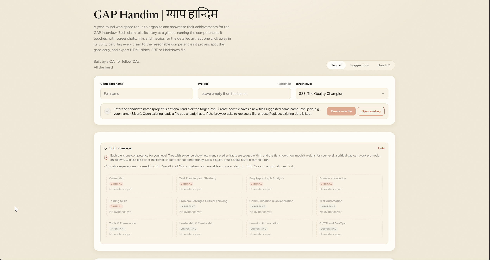
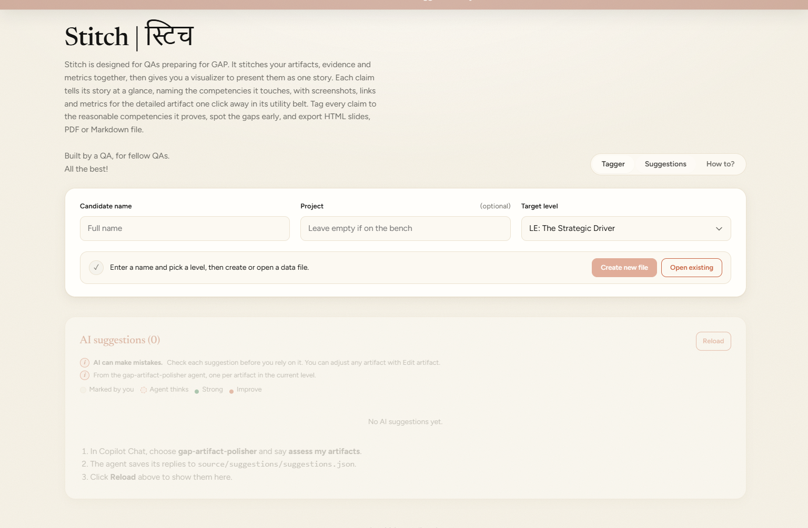
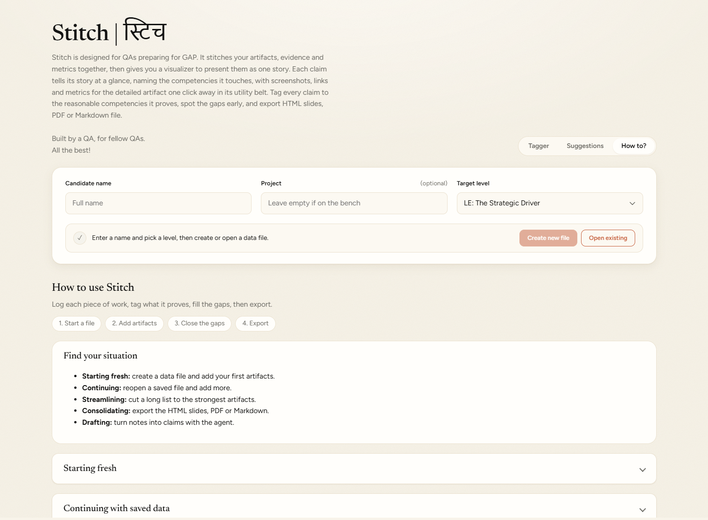

# GAP Handim

A single-file tool that helps QA engineers organize, tag and export their achievements for a GAP promotion case.

## Why it exists

I first built this for myself and the Signetic QAs. Then I thought it could help everyone going through GAP, so I opened it up as a shared tool.

## How it works

1. **Add artifacts:** Log each piece of work as you go.
2. **Review and refine:** Check coverage and tighten the wording until each artifact is strong.
3. **Export:** Produce HTML slides or a PDF for your GAP.

A simple agent can suggest changes to your artifacts. It uses only the document shared after the GAP KSS session, so its suggestions stay within what the panel expects.

## Screenshots

## Who this is for

QA Chapter engineers preparing a GAP promotion case. Pick your target level in the app. ASE has no tier list yet. Your evidence stays in your own JSON file.

## What it does

- **Logs artifacts:** Add each piece of work with the claim, problem, description, before and after, and the date it was done.
- **Tags competencies:** Tag each artifact to the GAP competencies it proves, with the impact and proof status.
- **Shows coverage:** Each level shows which competencies are covered, which are critical gaps, and how many artifacts support each one.
- **Filters the list:** Click a competency tile to filter your saved artifacts to that competency.
- **Holds attachments:** Add links, images and flow diagrams to the detailed evidence for each artifact.
- **Drafts with the agent (optional):** Turn notes into claims and get suggestions on wording, numbers and proof.
- **Keeps your data:** Saves everything to your own JSON file, so nothing is stored in the repo or sent elsewhere.
- **Exports for the panel:** Produces HTML slides, a PDF (via print) or Markdown.
- **Explains itself:** The How to page covers each situation and common troubleshooting.

## Find your situation

| Situation      | You want to                                     | Go to                                                              |
| -------------- | ----------------------------------------------- | ------------------------------------------------------------------ |
| Starting fresh | Create a data file and add your first artifacts | [Starting fresh](#starting-fresh)                                  |
| Continuing     | Reopen a saved file and add more                | [Continuing with saved data](#continuing-with-saved-data)          |
| Streamlining   | Cut a long list to the strongest artifacts      | [Streamlining a long list](#streamlining-a-long-list)              |
| Consolidating  | Export the HTML slides or Markdown              | [Consolidating the output](#consolidating-the-output)              |
| Drafting       | Turn notes into claims with the agent           | [Drafting claims from notes](#drafting-claims-from-notes-optional) |

## Folders

| Folder         | Contents                                                                                                 |
| -------------- | -------------------------------------------------------------------------------------------------------- |
| `view/`        | The app. Open `view/gap-handim-tagger.html` in Edge or Chrome.                                           |
| `source/`      | Your data files, including the file the agent writes. Exports go to `html/`, `pdf/` and `md/` inside it. |
| `images/`      | Screenshots used in this README.                                                                         |
| `source-deck/` | The original GAP deck. Do not edit.                                                                      |
| `knowledge/`   | The GAP competency matrix knowledge base.                                                                |

## Using the app

### Starting fresh

1. Open `view/gap-handim-tagger.html` in Edge or Chrome.
2. Enter the candidate name. Project is optional. Pick the target level. Each level shows only its own artifacts and coverage.
3. Click **Create new file** and save the suggested file, for example `your-name-l3.json`, in `source/working-json/`. To load a file you already have, click **Open existing**.

| If the file is   | Then                                   |
| ---------------- | -------------------------------------- |
| Existing         | It is loaded.                          |
| New              | It is created.                         |
| Asked to replace | Choose **Replace**. Your data is kept. |

### Adding artifacts

1. Add an artifact and fill in the fields:

| Field                                    | Required | Notes                                                                                      |
| ---------------------------------------- | -------- | ------------------------------------------------------------------------------------------ |
| Artifact, Problem it solved, Description | Yes      |                                                                                            |
| Competencies                             | Yes      | Tick what the work proves.                                                                 |
| Claim story                              | No       | Written by you. Map each ticked competency to the scenario behind it. Leave blank to skip. |
| Impact                                   | No       | Before, after, and how it was measured.                                                    |
| Proof                                    | No       | Links, screenshots or a flow.                                                              |

2. Click **Save artifact**. Save is blocked until the required fields and one competency are filled. Red tiles in Coverage are critical competencies with no evidence yet.

- **Agent drafts** are tagged Draft and stay out of Coverage, the HTML slides and the Markdown export until you edit them and click **Save artifact**.
- **Copy for agent** copies the artifact for the `gap-artifact-polisher` agent (see below).
- **AI suggestion**: paste the agent's reply here to keep it with the artifact. The **Suggestions** tab lists every reply. The app does not apply them: read each one, then edit the artifact yourself with **Edit artifact**. AI can make mistakes.

### Streamlining a long list

Keep only the strongest artifacts.

1. Edit or delete artifacts as needed.
2. Drag the grip on an artifact to reorder it.

### Consolidating the output

1. Click **Export** and choose **HTML slides**. The first export asks for your `source/` folder; the app remembers it. The app writes a folder named `<name>_<project>_<level>` (for example `your-name_bench_le`) into `source/html/`, replacing any previous export with the same name. It contains:

| File         | Contents                                                      |
| ------------ | ------------------------------------------------------------- |
| `index.html` | The HTML slides. Open it in any browser. No internet needed.  |
| `styles.css` | The slide styling.                                            |
| `data.json`  | A snapshot of the exported claims, with images as file paths. |
| `images/`    | Your screenshots at full resolution.                          |

2. Open `index.html`. The overview lists every artifact as a link, and the Contents button on each slide returns to it. Each artifact slide shows the claim story, figures, description, links and screenshot thumbnails together (a very long claim story moves to its own slide). Click a thumbnail to open a carousel of that artifact's screenshots. Use the arrow keys or the Prev and Next buttons, click a screenshot to enlarge it, and print from the browser for a PDF with one slide per page.
3. **PDF** and **Markdown** save to `source/pdf/` and `source/md/`, named `<name>_<project>_<level>.pdf` and `.md`. Each export replaces the previous file with the same name. The project part is left out when the project is empty.
4. Both use all ready artifacts for the current level. Tick **Include claim story in HTML slides and PDF** in the Export menu to include claim stories.

The order you set by dragging is saved in your data file. It sets the artifact numbers in the HTML slides and the order of the Markdown export.

## The agent: `gap-artifact-polisher`

The agent is an optional helper for GitHub Copilot Chat and Claude Code. It turns notes about your artifacts into claims in your JSON file. The app itself has no AI model.

| Assistant      | Where the agent is defined                      | How to call it                                  |
| -------------- | ----------------------------------------------- | ----------------------------------------------- |
| GitHub Copilot | `.github/agents/gap-artifact-polisher.agent.md` | Choose `gap-artifact-polisher` in Copilot Chat. |
| Claude Code    | `.claude/agents/gap-artifact-polisher.md`       | Ask for the `gap-artifact-polisher` subagent.   |

Both follow the same workflow and rules.

### What it does

- Checks each artifact against six required items: Point, Problem, Before, After, Consequence and Proof. Missing items are listed per artifact.
- Drafts every artifact that passes: a claim line, 2 to 4 description bullets, competencies (primary first), figure status and proof status.
- In draft mode, drafts incomplete artifacts, leaves missing numbers and proof empty, and asks one question per missing item.
- Asks questions when a claim's text is too thin to judge, in a Questions section of its reply.
- Shows all results in one message, then writes nothing until you confirm.
- After you confirm, appends the claims to `source/your-name-<level>.json`, keeps existing claims unchanged and checks that the JSON parses.

### What it does not do

- Invent numbers, links, competencies or policy.
- Change or delete existing claims.
- Edit the knowledge base, the source deck or the app.
- Write outside `source/`.

### Best ways to use it

1. Start the document with a `Level:` line (SE, SSE or LE). Then write one block per artifact with the labels Title, Point, Problem, Before, After, Consequence, Method and Proof. Labels are not case-sensitive and the order does not matter.
2. Fix every artifact the gate lists as failing before you ask for drafts.
3. For incomplete work, use **Copy for agent** in the app, then say "draft".
4. Describe the work in the language of the level you are applying for. The knowledge base says you are assessed against that level, not the one you hold.
5. Plan for about five to six strong artifacts. The agent flags Critical competencies for the target level that have no primary artifact.
6. Check each suggested competency, figure status and proof status in the app before you save.
7. Ask what a competency means, or which knowledge base section supports a suggestion. Answers come from the knowledge base only.

### What to expect

- One review message listing each artifact: passed or failed, what is missing, and for drafts, ranked competencies with knowledge base references, two claim story phrasings, description bullets and questions.
- Confirm all drafts at once, or name the changes and exclusions. Nothing is written before you confirm.
- Written claims are `status: ready` (or `draft`), `level` set to the target level and `createdAt` 2026-11-06.
- Then click **Open existing** in the app and choose the file. Drafts stay out of Coverage, the HTML slides and the Markdown export until you edit them and click **Save artifact**.

### Limitations

- Writes claims for the target level only: the `level` you give in the notes (SE, SSE or LE), with that level's matrix and file.
- Competency, figure and proof suggestions are judgement calls based on your wording. Check them.
- Accepts only `http` or `https` links, and does not open them.
- Uses only the 12 competency codes in Appendix A.
- `createdAt` is fixed to 2026-11-06, not the real date. To change it, edit the JSON file in a text editor.
- Your notes go to the assistant you use (Copilot or Claude). Do not paste confidential customer data.

### What the knowledge base covers

`knowledge/GAP-competency-matrix-knowledge-base.md` is written from the GAP deck for QA Chapter engineers preparing for the promotion cycle. The agent reads sections 6, 9.1 to 9.3 (the matrix for the target level), 12, 13, 14, 15, 19 and Appendix A.

| Section         | Content                                                              |
| --------------- | -------------------------------------------------------------------- |
| 4               | What GAP is and is not                                               |
| 5               | Eligibility: Team Manager approval, self willing, confirmed with QSG |
| 6               | The 12 competencies and their codes                                  |
| 7               | Tiers: Critical, Important, Supporting                               |
| 8               | Role ladder: ASE, SE, SSE, LE                                        |
| 9               | Role matrices for SE, SSE and LE (no ASE matrix)                     |
| 10 to 11        | One piece of work, many competencies, with a worked example          |
| 12              | Coverage, not collection                                             |
| 13 to 14        | How to prepare and the evidence pack template                        |
| 15              | Numbers and impact: baseline, delta, consequence                     |
| 16              | How the promotion decision is made in three layers                   |
| 17              | Team activity and Q and A                                            |
| 19 to 20        | Rules digest and FAQ                                                 |
| 21              | Source integrity notes: known gaps in the deck                       |
| Appendix A to C | Competency code legend, artifact mappings and glossary               |

The knowledge base marks which facts come from the slides, which are presenter notes, and which are derived. Example numbers in it are illustrative, not benchmarks. Read section 21 before relying on counts or the team activity answers.

## Drafting claims from notes (optional)

Use the `gap-artifact-polisher` agent in GitHub Copilot Chat or Claude Code to draft claims from your notes. Notes you paste go to that assistant. Do not paste confidential customer data.

1. In Copilot Chat, choose `gap-artifact-polisher`. In Claude Code, ask for the `gap-artifact-polisher` subagent.
2. Paste a document with one block per artifact: Point, Problem, Before, After, Consequence, Method (estimates only) and Proof.
3. Complete any artifacts the agent lists as incomplete. It drafts the rest.
4. Confirm the drafts. The agent writes `source/your-name-<level>.json` (for example `source/your-name-le.json`) and its replies to `suggestions.json` beside it.
5. In the app, click **Open existing** and choose that file. The app reloads the file automatically when it changes on disk.

Draft mode is for unfinished artifacts. Paste the output of **Copy for agent** and say "draft" (the agent also uses it when required items are blank). The agent skips the required-items gate, saves the artifact with `status: draft`, ranks competencies with knowledge base references, offers wording, and asks one question per missing item. It never fills in numbers or proof.

### Required and suggested

| You provide                                                                                             | The agent suggests                                                                        |
| ------------------------------------------------------------------------------------------------------- | ----------------------------------------------------------------------------------------- |
| Point, Problem, Before and After (each with a number and unit), Consequence, Proof (link or image path) | Claim line, description bullets, competencies (first is primary), figure and proof status |
| Method, when Before is an estimate or "no baseline"                                                     |                                                                                           |

Check the suggestions in the review.

## Competencies and claim story

The app does not suggest competencies or write claim stories. You choose both.

- **Competencies touched**: tick only what the artifact proves. Most substantial artifacts touch four to six.
- **Claim story** is optional and written by you. Map each ticked competency to the scenario behind it. Leave it blank to skip.

## Continuing with saved data

- Click **Open existing** and choose your JSON file.
- Edited the JSON by hand, or changed by the agent? The app reloads the file when you return to its window and shows "File changed outside the app". Review and save again.
- Before big changes, click **Backup** to download a copy of your data file.
- Notes from the agent: see [Drafting claims from notes](#drafting-claims-from-notes-optional).

## Troubleshooting

| Problem                                         | Fix                                                                                     |
| ----------------------------------------------- | --------------------------------------------------------------------------------------- |
| Create new file is greyed out                   | Enter the candidate name.                                                               |
| Access refused                                  | Click **Grant access** and choose Allow. If there is no prompt, IT policy may block it. |
| "File changed outside the app"                  | The file was reloaded. Review and save again.                                           |
| "This browser cannot create or save data files" | Open the app in Microsoft Edge or Chrome.                                               |
| Export Markdown downloads a file                | The save dialog could not open. Find the file in your Downloads folder.                 |
| Where is my data?                               | Only in your JSON file. Keep a backup.                                                  |
