# GAP — Growth Assessment Policy: Competency Matrix and Focus Areas

> Subtitle from the title slide: *Understanding the GAP — Growth Assessment Policy: what competencies mean, how to evidence them, and how promotion is actually decided.*

---

## 1. Reading guide and conventions

**Context:** how to read and cite this document. Read this section first.

### 1.1 Origin tags

| Tag | Meaning | Use when answering |
|---|---|---|
| `[Slide]` | Text printed on the slide. | Treat as the stated GAP content. |
| `[Note]` | Presenter speaker note. | Treat as the presenter's interpretation and emphasis, not formal policy text. Say so when quoting it. |
| `[Derived]` | Restatement, cross-tabulation or count computed from `[Slide]` content. | Treat as convenience only. It adds no new facts. |

### 1.2 ID scheme

Facts are numbered `S<slide>-<n>`, for example `S06-02` is the second fact on slide 6. Notes are numbered `N<slide>`, for example `N06`. Cite IDs when you answer, so a reader can trace the claim.

### 1.3 Answering rules for an LLM

1. Answer only from this document. If the source is silent, say it is not covered.
2. Before answering about competency counts, the ASE matrix, the coverage grid or the team-activity answers, read Section 21 (source integrity). The deck has known gaps there.
3. GAP is role-relative. Use the matrix for the role the candidate is applying **for** (S07 and N07).
4. Example numbers (26 hrs, 6 hrs, 77%, 14 hrs, 3 hrs, 4 days, 1 day and similar) are illustrative per the deck. Never present them as real benchmarks.
5. Distinguish "policy" (slide) from "advice" (note). The deck mixes both.

### 1.4 Section index

| § | Topic | Slides |
|---|---|---|
| 2 | Knowledge map | all |
| 3 | Session overview and agenda | S01, S02 |
| 4 | What GAP is and is not | S03 |
| 5 | Eligibility | S04 |
| 6 | Competency library | S05 |
| 7 | Tier weighting | S06 |
| 8 | Role ladder | S07 |
| 9 | Role matrices (SE, SSE, LE) | S08, S09, S10 |
| 10 | One piece of work, many competencies | S11 |
| 11 | Worked example: PR review bot | S12 |
| 12 | Coverage, not collection | S13 |
| 13 | How to prepare | S14 |
| 14 | Evidence pack template | S15 |
| 15 | Numbers and impact | S16 |
| 16 | How the promotion decision is made | S17 |
| 17 | Team activity and Q&A | S18, S19 |
| 18 | Presenter notes index | all |
| 19 | Rules digest | derived |
| 20 | FAQ for retrieval | derived |
| 21 | Source integrity notes | all |
| A–E | Appendices (legend, mappings, glossary, slide audit, machine-readable data) | all |

---

## 2. Knowledge map

**Context:** one-page overview of everything in this document. `[Derived]`

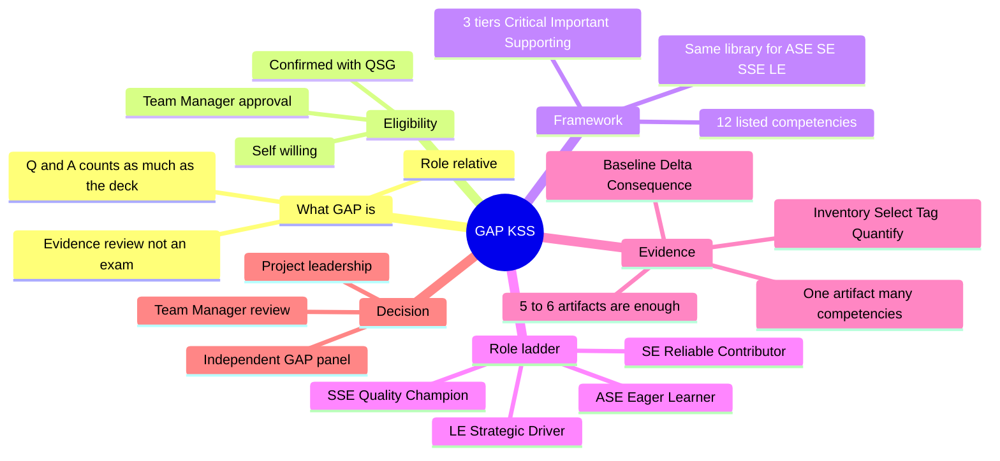

---

## 3. Session overview and agenda (S01, S02)

**Context:** the session this deck belongs to, its timing, and its agenda.

### 3.1 Title slide (S01)

| ID | Type | Content |
|---|---|---|
| S01-01 | Slide | Label: KSS SESSION · QA CHAPTER |
| S01-02 | Slide | Title: **Competency Matrix & Focus Areas** |
| S01-03 | Slide | Subtitle: Understanding the GAP — Growth Assessment Policy: what competencies mean, how to evidence them, and how promotion is actually decided. |
| N01 | Note | Open by setting expectations: this is an awareness session, not an evaluation. 30 minutes of content, then 45 minutes where I want real questions. Tell them the deck will be shared so they should listen rather than transcribe. |

### 3.2 Agenda (S02)

| ID | Type | # | Agenda item |
|---|---|---|---|
| S02-01 | Slide | 1 | What GAP is — and what it is not |
| S02-02 | Slide | 2 | The competency framework and its three tiers |
| S02-03 | Slide | 3 | How the matrix shifts across ASE → SE → SSE → LE |
| S02-04 | Slide | 4 | One piece of work, many competencies |
| S02-05 | Slide | 5 | Building your evidence pack and finding your numbers |
| S02-06 | Slide | 6 | How the promotion decision is actually made |
| S02-07 | Slide | — | Slide heading: "What we will cover". A label reading "45 min" also appears (see Section 21, item 8). |
| N02 | Note | — | Flag that the heaviest section is evidence-building, because that is where most first-time candidates lose marks. Keep to time so Q&A stays intact. |

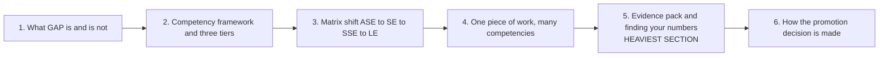

---

## 4. What GAP is and is not (S03)

**Context:** the definition and boundaries of GAP, from the "Setting the frame" slide titled "GAP is an evidence review, not an exam".

### 4.1 What GAP is

| ID | Type | Content |
|---|---|---|
| S03-01 | Slide | A structured technical review of the growth you have already demonstrated |
| S03-02 | Slide | Judged on evidence — artifacts, outcomes, numbers |
| S03-03 | Slide | Role-relative: measured against the next level, not against your peers |
| S03-04 | Slide | A conversation — the Q&A carries as much weight as the deck |

### 4.2 What GAP is not

| ID | Type | Content |
|---|---|---|
| S03-05 | Slide | A memory test on tools, definitions or theory |
| S03-06 | Slide | A reward for time served in the role |
| S03-07 | Slide | A checklist needing one separate trophy per competency |
| S03-08 | Slide | A surprise — the matrix is published, so nothing here is hidden |
| N03 | Note | Land two messages hard: (1) nothing is hidden, the matrix is public, and (2) the panel scores what you can show, not what you claim. If you cannot point to an artifact, it did not happen as far as GAP is concerned. |

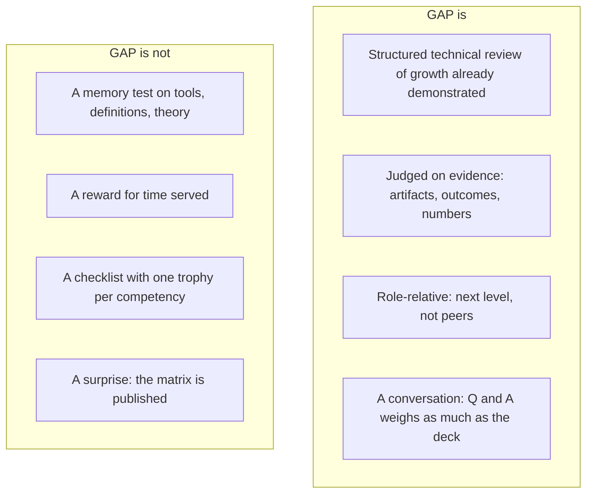

---

## 5. Eligibility (S04)

**Context:** who can enter the GAP cycle. Section label on the slide: "WHO CAN ENTER THE CYCLE". Tag: "ENTRY CHECK".

| ID | Type | Content |
|---|---|---|
| S04-01 | Slide | Heading: **Three conditions, all required** |
| S04-02 | Slide | None of the three is optional. Confirm all of them are in place before you start building your case. |
| S04-03 | Slide | Condition 1, **Team Manager Approval**: Your Team Manager must approve you entering the cycle. |
| S04-04 | Slide | Condition 2, **Self Willing**: You must be willing to go through the cycle yourself. |
| S04-05 | Slide | Condition 3, **Confirmed with QSG**: Must be confirmed with the QSG — the QA Strategic Guild. |

No presenter note exists for this slide.

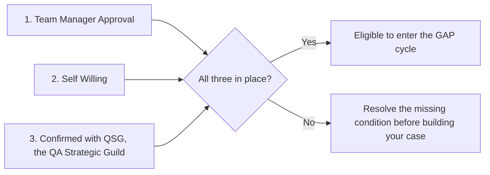

---

## 6. Competency library (S05)

**Context:** the shared vocabulary of competencies. Section label: "THE BUILDING BLOCKS". Title: "The competency framework".

| ID | Type | Content |
|---|---|---|
| S05-01 | Slide | Every role — ASE, SE, SSE and LE — is assessed against the same competency library. |
| S05-02 | Slide | What changes between roles is which tier a competency sits in, and how much depth is expected. |
| N05 | Note | Read the list out but do not define each one — the definitions live in the GAP document. The point of this slide is that the vocabulary is fixed and shared across all four roles. ACTION FOR ME: fill in the 13th competency before delivering. |

### 6.1 Competencies as listed on the slide

| # | ID | Competency | Code (Appendix A) |
|---|---|---|---|
| 1 | S05-C01 | Ownership | OWN |
| 2 | S05-C02 | Domain Knowledge | DOM |
| 3 | S05-C03 | Testing Skills | TST |
| 4 | S05-C04 | Bug Reporting & Analysis | BUG |
| 5 | S05-C05 | Test Planning and Strategy | TPS |
| 6 | S05-C06 | Communication & Collaboration | COM |
| 7 | S05-C07 | Tools & Frameworks | TLS |
| 8 | S05-C08 | Problem Solving & Critical Thinking | PSC |
| 9 | S05-C09 | Test Automation | AUT |
| 10 | S05-C10 | Leadership & Mentorship | LDR |
| 11 | S05-C11 | Learning & Innovation | LRN |
| 12 | S05-C12 | CI/CD and DevOps | CID |

The slide lists twelve competencies. The note refers to a 13th that was still to be filled in. See Section 21, item 1.

---

## 7. Tier weighting (S06)

**Context:** how competencies are weighted. Section label: "HOW WEIGHTING WORKS". Title: "Three tiers, three different jobs to do".

| ID | Type | Tier | Meaning (verbatim from slide) |
|---|---|---|---|
| S06-01 | Slide | **Critical** | A visible gap here impact the promotion on its own. Bring your deepest, best-evidenced work and expect the panel to dig. |
| S06-02 | Slide | **Important** | The panel expects a solid, consistent standard here — not brilliance. |
| S06-03 | Slide | **Supporting** | These show direction of travel. Evidence of initiative and learning counts even where the depth is still building. |
| S06-04 | Slide | (rule) | Note: All competencies are necessary the only difference is each of them carry variable weightage for evaluation |
| N06 | Note | (advice) | This is the slide people misread. Emphasise: a weak Critical competency is fatal; a weak Supporting competency is not. So prioritise prep time accordingly instead of spreading it evenly across all thirteen. |

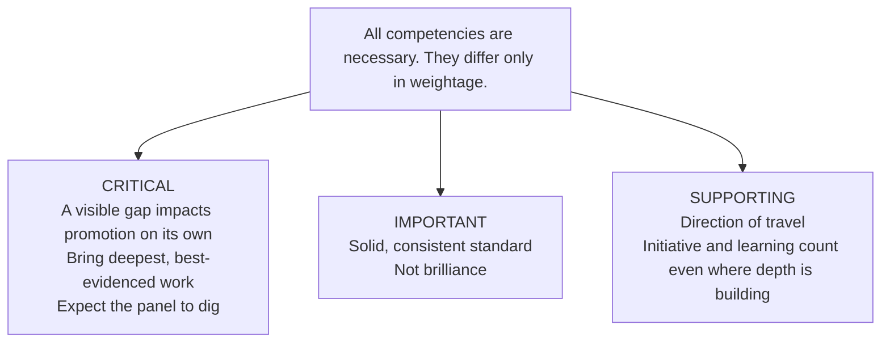

---

## 8. Role ladder (S07)

**Context:** the four roles and how the centre of gravity moves. Section label: "ASE → SE → SSE → LE". Title: "Same competencies, moving centre of gravity".

| ID | Type | Step | Role | Persona | Description (verbatim) |
|---|---|---|---|---|---|
| S07-01 | Slide | 1 | ASE | The Eager Learner | New to software quality: eager to learn, best with clear direction, and growing fast on feedback. |
| S07-02 | Slide | 2 | SE | The Reliable Contributor | Owns features end to end with minimal supervision: digs past the happy path, backs bugs with real investigation |
| S07-03 | Slide | 3 | SSE | The Quality Champion | Thrives in complexity: brings deep technical skill to extend the team's tooling, turns ambiguous problems into testable plans |
| S07-04 | Slide | 4 | LE | The Strategic Driver | Owns quality across a whole project: sets standards, translates technical risk into business impact for engineers |
| N07 | Note | — | — | — | The single most useful takeaway on this slide: you are assessed against the level you are applying FOR, not the one you hold. So describe your work in the language of the next role up. |

The role abbreviations are not expanded anywhere in the source.

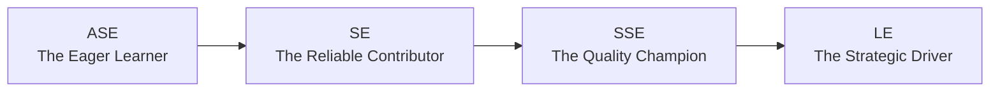

---

## 9. Role matrices: SE, SSE, LE (S08, S09, S10)

**Context:** which tier each competency sits in for each role. Section label on each slide: "ROLE MATRIX". The deck gives matrices for SE, SSE and LE only. There is no ASE matrix (Section 21, item 2).

### 9.1 SE Competency matrix (S08)

| ID | Tier | Count | Competencies |
|---|---|---|---|
| S08-01 | **Critical** | 4 | Ownership; Communication & Collaboration; Testing Skills; Bug Reporting & Analysis |
| S08-02 | **Important** | 5 | Domain Knowledge; Tools & Frameworks; Problem Solving & Critical Thinking; Test Planning & Strategy; Test Automation |
| S08-03 | **Supporting** | 3 | Leadership & Mentorship; Learning & Innovation; CI/CD and DevOps |

### 9.2 SSE Competency matrix (S09)

| ID | Tier | Count | Competencies |
|---|---|---|---|
| S09-01 | **Critical** | 5 | Ownership; Domain Knowledge; Testing Skills; Bug Reporting & Analysis; Test Planning and Strategy |
| S09-02 | **Important** | 4 | Communication & Collaboration; Tools & Frameworks; Problem Solving & Critical Thinking; Test Automation |
| S09-03 | **Supporting** | 3 | Leadership & Mentorship; Learning & Innovation; CI/CD and DevOps |

### 9.3 LE Competency matrix (S10)

| ID | Tier | Count | Competencies |
|---|---|---|---|
| S10-01 | **Critical** | 6 | Ownership; Problem Solving & Critical Thinking; Communication & Collaboration; Test Automation; Leadership & Mentorship; Test Planning and Strategy |
| S10-02 | **Important** | 4 | Bug Reporting & Analysis; Domain Knowledge; Tools & Frameworks; Testing Skills |
| S10-03 | **Supporting** | 2 | Learning & Innovation; CI/CD and DevOps |

### 9.4 Presenter notes for the three matrix slides

| ID | Slide | Note (verbatim) |
|---|---|---|
| N08 | S08 (SE) | Walk the table slowly — this is the anchor slide of the session. Ask an SSE in the room which tier they assumed automation was in; most guess Critical. That misconception is exactly why we are running this KSS. |
| N09 | S09 (SSE) | Identical text to N08 in the source. |
| N10 | S10 (LE) | Identical text to N08 in the source. |

### 9.5 Cross-role tier comparison `[Derived]`

Computed directly from 9.1 to 9.3. No ASE column because the source has none.

| Competency | SE | SSE | LE | Pattern |
|---|---|---|---|---|
| Ownership | Critical | Critical | Critical | Critical at every level shown |
| Communication & Collaboration | Critical | Important | Critical | Dips at SSE |
| Testing Skills | Critical | Critical | Important | Drops at LE |
| Bug Reporting & Analysis | Critical | Critical | Important | Drops at LE |
| Domain Knowledge | Important | Critical | Important | Critical only at SSE |
| Test Planning and Strategy | Important | Critical | Critical | Critical from SSE up |
| Problem Solving & Critical Thinking | Important | Important | Critical | Critical only at LE |
| Test Automation | Important | Important | Critical | Critical only at LE |
| Tools & Frameworks | Important | Important | Important | Important at every level shown |
| Leadership & Mentorship | Supporting | Supporting | Critical | Critical only at LE |
| Learning & Innovation | Supporting | Supporting | Supporting | Supporting at every level shown |
| CI/CD and DevOps | Supporting | Supporting | Supporting | Supporting at every level shown |

Tier counts `[Derived]`:

| Role | Critical | Important | Supporting | Total |
|---|---|---|---|---|
| SE | 4 | 5 | 3 | 12 |
| SSE | 5 | 4 | 3 | 12 |
| LE | 6 | 4 | 2 | 12 |

Test Automation is Important for SE and SSE and only becomes Critical at LE. This is the misconception N08 says many people hold.

```mermaid
flowchart LR
    subgraph SEm["SE"]
        direction TB
        SE_C["Critical 4: Ownership, Communication, Testing Skills, Bug Reporting"]
        SE_I["Important 5: Domain, Tools, Problem Solving, Test Planning, Test Automation"]
        SE_S["Supporting 3: Leadership, Learning, CI/CD"]
    end
    subgraph SSEm["SSE"]
        direction TB
        SSE_C["Critical 5: Ownership, Domain, Testing Skills, Bug Reporting, Test Planning"]
        SSE_I["Important 4: Communication, Tools, Problem Solving, Test Automation"]
        SSE_S["Supporting 3: Leadership, Learning, CI/CD"]
    end
    subgraph LEm["LE"]
        direction TB
        LE_C["Critical 6: Ownership, Problem Solving, Communication, Test Automation, Leadership, Test Planning"]
        LE_I["Important 4: Bug Reporting, Domain, Tools, Testing Skills"]
        LE_S["Supporting 2: Learning, CI/CD"]
    end
    SEm --> SSEm --> LEm
```

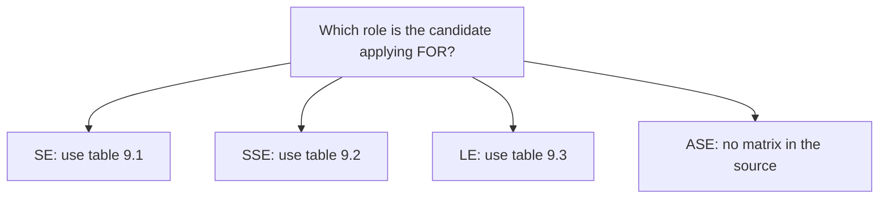

---

## 10. One piece of work, many competencies (S11)

**Context:** the core idea of evidence mapping, shown with one artifact. Section label: "THE CORE IDEA". Title: "One piece of work evidences many competencies".

| ID | Type | Content |
|---|---|---|
| S11-01 | Slide | Stop asking "what did I do for Test Automation?" Start from the work itself and ask what it required of you. Every answer is a competency — most substantial artifacts touch four to six. |
| S11-02 | Slide | THE ARTIFACT: **Test Plan for the Contract Review release** |
| S11-03 | Slide | Then ask it again for every artifact you plan to present. |
| S11-04 | Slide | One artifact, five competencies — and only one of them is the obvious one. |
| N11 | Note | This is the message people remember from the session. Say it plainly: writing a test plan is not one competency. Ask the room to name a sixth competency the plan could touch — CI/CD if it defined the pipeline gates, Tools if it introduced a new template. |

### 10.1 Competencies the test plan evidences

| ID | Competency | Link strength | How the artifact evidences it |
|---|---|---|---|
| S11-C1 | Test Planning and Strategy | PRIMARY | Scope, risk-based prioritisation, entry and exit criteria |
| S11-C2 | Domain Knowledge | STRONG | Contract review rules, state lending constraints, funding hand-offs |
| S11-C3 | Communication & Collaboration | STRONG | Reviewed with dev, BA and the funding team; sign-off recorded |
| S11-C4 | Learning & Innovation | IF EARNED | Used an AI assistant to draft coverage — reusable by the whole team |
| S11-C5 | Ownership | IMPLICIT | You drove it to sign-off without being chased |

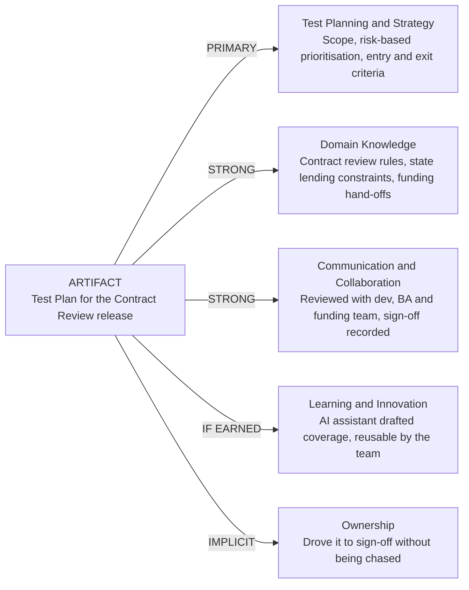

---

## 11. Worked example: the PR review bot (S12)

**Context:** a second artifact-to-competency example, with before and after numbers. Section label: "MAPPING ENGINEERING WORK". Title: "Second example — you built a PR review bot".

### 11.1 What you actually did

| ID | Type | Step | Content |
|---|---|---|---|
| S12-01 | Slide | Problem | Automation PRs were sitting unreviewed for days, so regression coverage lagged behind the sprint. |
| S12-02 | Slide | Build | You built a bot that reviews automation PRs against the framework conventions and posts findings automatically. |
| S12-03 | Slide | Adopt | You wired it into the pipeline and documented it so the whole team could adopt it. |

### 11.2 Impact metrics (illustrative)

| ID | Metric | Value |
|---|---|---|
| S12-04 | Median PR → merge, before | 26 hrs |
| S12-05 | Median PR → merge, after | 6 hrs |
| S12-06 | Reduction in review lag | 77% |

Footnote on slide (S12-07): *Figures are illustrative — use your own repository data.*

### 11.3 Competencies evidenced

| ID | Competency | Why (verbatim) |
|---|---|---|
| S12-C1 | Test Automation | You extended the framework, not just used it |
| S12-C2 | Tools & Frameworks | You chose and integrated the tooling |
| S12-C3 | CI/CD and DevOps | It runs as a pipeline gate |
| S12-C4 | Problem Solving | You diagnosed a process bottleneck, not a bug |
| S12-C5 | Learning & Innovation | Nobody asked for it — you saw it and built it |
| S12-C6 | Leadership & Mentorship | The team adopted it and you supported them |
| S12-C7 | Ownership | You still maintain it |

| ID | Type | Content |
|---|---|---|
| N12 | Note | The reframe here: one engineering side-project can carry seven competencies including three Critical ones. But only if you measured the before state. Tell them to pull those numbers now, before the cycle closes, because reconstructing a baseline later is nearly impossible. |

The "three Critical ones" claim does not match any single role matrix. See Section 21, item 4.

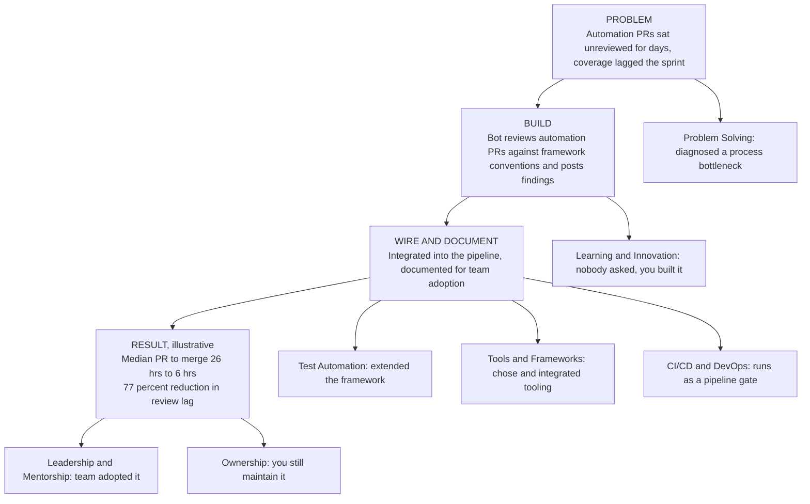

---

## 12. Coverage, not collection (S13)

**Context:** how many artifacts a candidate needs. Section label: "COVERAGE, NOT COLLECTION". Title: "You do not need one achievement per competency".

| ID | Type | Content |
|---|---|---|
| S13-01 | Slide | Five to six well-chosen artifacts will cover the whole matrix between them. |
| S13-02 | Slide | Depth on a few beats a thin line for each. |
| N13 | Note | This slide kills the most common prep mistake: building thirteen weak stories. Show that five real artifacts already cover everything. Also give them permission to say "that is my weakest area and here is my plan" — panels reward that over a stretched claim. |

### 12.1 Grid column headers (competency codes)

`OWN` `DOM` `TST` `BUG` `TPS` `COM` `TLS` `PSC` `AUT` `LDR` `LRN` `CID`

Twelve codes. The expansion is in Appendix A and is inferred from the code letters.

### 12.2 Grid rows (example artifacts)

| ID | Example artifact |
|---|---|
| S13-A1 | Contract Review test strategy |
| S13-A2 | Spark regression automation suite |
| S13-A3 | PR review bot |
| S13-A4 | QA onboarding & Bug Hunt program |
| S13-A5 | UAT sanity execution plan |

Which grid cells are marked did not survive the text export. See Section 21, item 5. Sourced mappings that do exist are consolidated in Appendix B.

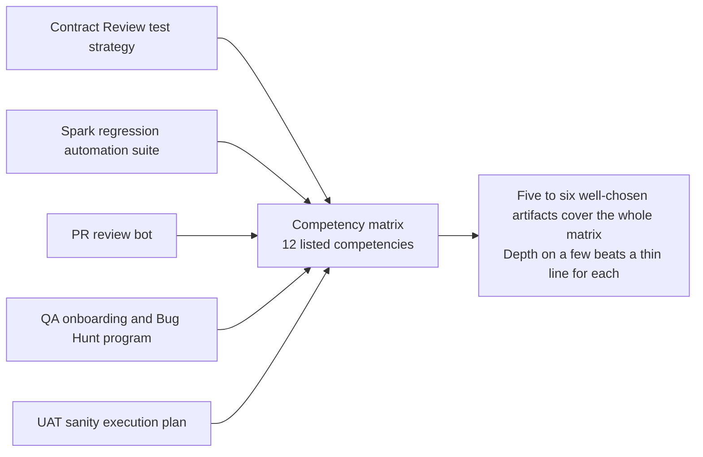

---

## 13. How to prepare (S14)

**Context:** the four-step preparation method. Section label: "HOW TO PREPARE". Title: "Start from your artifacts, not from the matrix".

| ID | Type | Step | Name | Instruction (verbatim) |
|---|---|---|---|---|
| S14-01 | Slide | 1 | Inventory | List everything you shipped this cycle — plans, suites, tools, docs, sessions you ran, incidents you handled. Do not filter yet. |
| S14-02 | Slide | 2 | Select | Pick the five or six with the most real impact. Prefer work you can point at over work you can only describe. |
| S14-03 | Slide | 3 | Tag | For each one, mark the competencies it evidences — one primary, the rest secondary. Then check the matrix for holes. |
| S14-04 | Slide | 4 | Quantify | Attach a before and after number to each. Then attach the proof: the link, the dashboard, the PR, the screenshot. |
| N14 | Note | — | — | Stress the direction of travel: matrix-first prep produces generic claims, artifact-first prep produces specifics. Also warn that step 1 usually surfaces work they had forgotten, which is often their strongest evidence. |

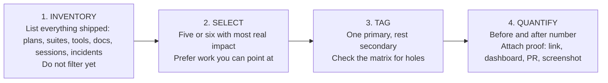

---

## 14. Evidence pack template (S15)

**Context:** the one-table format for presenting evidence. Section label: "TEMPLATE". Title: "Build your evidence pack in one table".

### 14.1 Template columns

| Artifact | Problem it solved | Competencies touched | Before → After (Impact) | Proof |
|---|---|---|---|---|

### 14.2 Example rows from the slide

| ID | Artifact | Problem it solved | Competencies touched | Before → After (Impact) | Proof |
|---|---|---|---|---|---|
| S15-01 | Contract Review test strategy | Release scope was unclear and regression kept slipping | TPS (P) · Domain · Communication · Ownership | Sign-off 4 days → 1 day | Lucidchart flow + plan |
| S15-02 | PR review bot | Automation PRs sat unreviewed, coverage lagged the sprint | Automation (P) · Tools · CI/CD · Innovation | PR merge 26h → 6h | Repo + bot logs |
| S15-03 | UAT sanity execution plan | Two squads duplicating effort across sanity cycles | Ownership (P) · Planning · Leadership | Cycle 3 days → 1.5 days | Squad plan + results |
| S15-04 | QA onboarding Bug Hunt | New joiners took a full sprint to find real defects | Leadership (P) · Innovation · Bug Reporting | Ramp-up 4 wks → 2 wks | Game + scores |
| S15-05 | *(blank row)* | | | | |

| ID | Type | Content |
|---|---|---|
| S15-06 | Slide | Mark one primary competency per artifact (P). Then map the table against your role matrix — anything in the Critical tier with no primary artifact behind it is what you fix next. |
| N15 | Note | Tell them to keep this table as a living document from day one of the cycle, not build it at the end. The blank last row is deliberate — invite them to fill it during the Q&A with their own work and get feedback live. |

### 14.3 Column purposes `[Derived]`

| Column | Purpose |
|---|---|
| Artifact | The piece of work shipped. |
| Problem it solved | Why the work existed. |
| Competencies touched | One primary (P), the rest secondary. |
| Before → After (Impact) | Baseline, delta and consequence in numbers. |
| Proof | The verifiable link, repo, dashboard, PR or screenshot. |

### 14.4 Gap-check procedure `[Derived]`

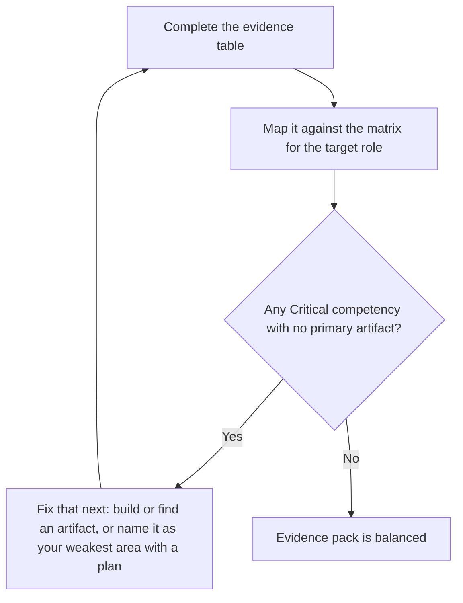

---

## 15. Numbers and impact (S16)

**Context:** how to quantify evidence and where to find the numbers. Section label: "MAKING IMPACT LEGIBLE". Title: "Come with numbers, and show before versus after".

| ID | Type | Content |
|---|---|---|
| S16-01 | Slide | "I improved the regression suite" is an opinion. |
| S16-02 | Slide | "Regression went from 14 hours to 3 hours, so we moved to twice-weekly releases" is evidence. |
| S16-03 | Slide | Find your baseline, then your delta, then the consequence. |
| S16-04 | Slide | Footnote: *Illustrative figures. If you have no baseline, say so and give the closest honest estimate with your method — a panel accepts that; it does not accept an invented number.* |
| N16 | Note | Give the three-part formula out loud: baseline, delta, consequence. The consequence is the part people skip and it is the part that converts a metric into business impact. Also warn against unverifiable numbers — the panel will ask how you measured it. |

### 15.1 Where to find your numbers

| ID | Source system | Metrics available |
|---|---|---|
| S16-05 | Jira | Cycle time, reopen rate, defects by module |
| S16-06 | TestRail | Cases added, execution time, pass rate trend |
| S16-07 | Pipeline history | Run duration, flake rate, failed builds |
| S16-08 | Git | PR raised-to-merge time, review comments per PR |
| S16-09 | Release records | Sign-off duration, escaped defects |
| S16-10 | Calendar and effort logs | Hours saved per cycle |

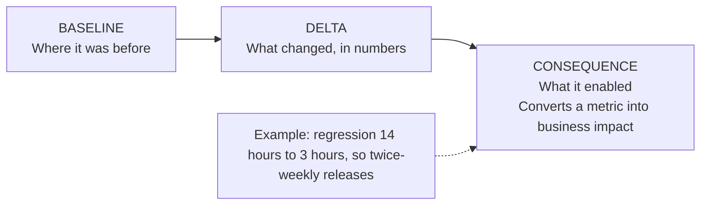

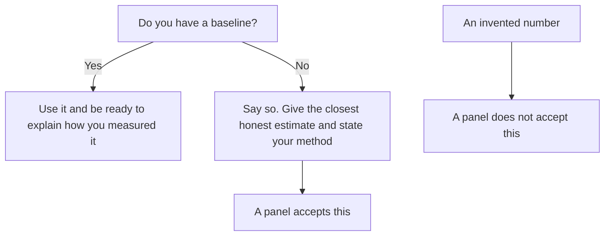

---

## 16. How the promotion decision is made (S17)

**Context:** the three-layer decision process. Section label: "THREE LAYERS". Title: "How the promotion decision is actually made".

| ID | Type | Content |
|---|---|---|
| S17-01 | Slide | All three layers must align. Clearing the panel is necessary but not sufficient. |
| N17 | Note | Be straight about the veto — people hear about it informally and assume it is arbitrary. Frame it as a consistency check across the organisation. Also stress the first layer: strong day-to-day performance is what gets you nominated in the first place, and no presentation rescues a weak year. |

### 16.1 Layer 1: your project leadership, project-level recommendation

| ID | Content |
|---|---|
| S17-L1-1 | Your project raises and endorses the case. |
| S17-L1-2 | Based on day-to-day performance your leads have observed directly. |
| S17-L1-3 | This is the gate you influence continuously, not in one presentation. |

### 16.2 Layer 2: independent jury, GAP panel recommendation

| ID | Content |
|---|---|
| S17-L2-1 | A jury is selected from outside your project. |
| S17-L2-2 | You present your case, then face open Q&A. |
| S17-L2-3 | They know your work only through what you show them — so context matters. |
| S17-L2-4 | The panel gives the verdict. |

### 16.3 Layer 3: approval authority, Team Manager review

| ID | Content |
|---|---|
| S17-L3-1 | Team Managers review the outcome. |
| S17-L3-2 | They hold power and can stop a promotion the panel passed. |
| S17-L3-3 | Consistency, conduct and readiness for the wider role all weigh here. |

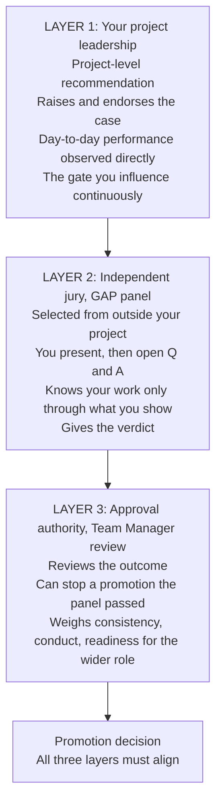

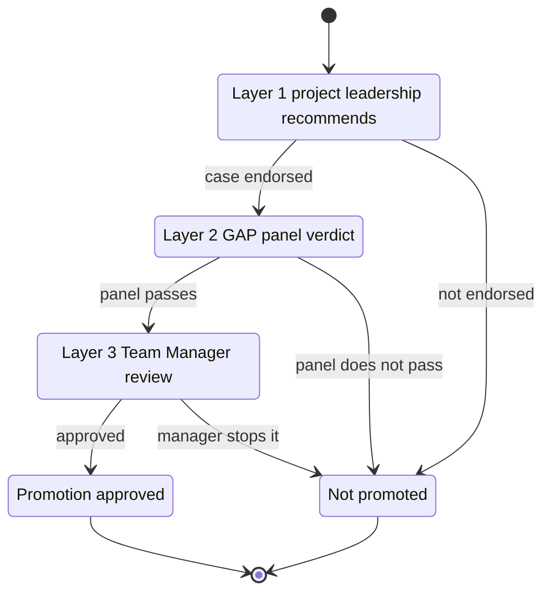

The state diagram is `[Derived]`. It expresses "all three layers must align" and "Team Managers can stop a promotion the panel passed". It does not claim a formal sequence beyond the slide's numbering.

---

## 17. Team activity and Q&A (S18, S19)

**Context:** the closing interactive exercise and Q&A. Both slides are unnumbered in the export and are numbered here by position.

### 17.1 Team activity (S18)

Section label: "TEAM ACTIVITY". Title: "Your turn — name the competencies".

| ID | Type | Content |
|---|---|---|
| S18-01 | Slide | You are each holding one competency. As a scenario is read out, come to the stage if yours is in it — then justify how. |

| ID | Scenario | Text (verbatim) |
|---|---|---|
| S18-02 | 1. The missing coverage doc | Nobody could say what the regression suite actually covered, so every new joiner asked the same questions. You wrote a living coverage document mapping each module to its cases and risk level, and release sign-off now runs off it. |
| S18-03 | 2. AI-drafted regression cases | Drafting regression cases for each release was eating two days a sprint. You built an AI-assisted workflow that drafts them from the acceptance criteria, reviewed every one yourself, and folded it into the team's template — now half a day. |
| S18-04 | 3. The bug only production sees | A defect appears in production but never in staging, and three people have already failed to reproduce it. You compare the two configurations, spot that staging never receives the same payment-schedule payload, and reproduce it first try. |

There is no presenter note and no answer key. See Section 21, item 6.

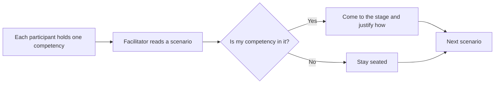

### 17.2 Q&A (S19)

| ID | Type | Content |
|---|---|---|
| S19-01 | Slide | Label: OVER TO YOU. Title: **Q&A** |
| S19-02 | Slide | Questions on the matrix, the evidence pack, or your own case. |
| (ref) | Note (N01) | The session plan reserves 45 minutes for real questions after 30 minutes of content. |

---

## 18. Presenter notes index

**Context:** where every presenter note lives. Notes are presenter guidance, not formal policy.

| Note | Slide | Core message |
|---|---|---|
| N01 | S01 | Awareness session, not an evaluation. 30 min content, 45 min questions. Deck will be shared. |
| N02 | S02 | Evidence-building is the heaviest section. Keep to time. |
| N03 | S03 | Nothing is hidden. The panel scores what you can show. No artifact means it did not happen. |
| N05 | S05 | Do not define each competency. Vocabulary is fixed across roles. 13th competency to be filled in. |
| N06 | S06 | Weak Critical is fatal, weak Supporting is not. Prioritise prep by tier. |
| N07 | S07 | Assessed against the level you apply FOR. Use next-role language. |
| N08–N10 | S08–S10 | Walk the table slowly. Ask an SSE which tier they assumed for automation. Most guess Critical. |
| N11 | S11 | A test plan is not one competency. Ask for a sixth competency. |
| N12 | S12 | One side-project can carry seven competencies. Measure the before state. |
| N13 | S13 | Kill the thirteen-weak-stories mistake. Permission to name your weakest area with a plan. |
| N14 | S14 | Artifact-first beats matrix-first. Inventory often surfaces forgotten strong work. |
| N15 | S15 | Keep the table living from day one. Blank row is deliberate. |
| N16 | S16 | Baseline, delta, consequence. Warn against unverifiable numbers. |
| N17 | S17 | Be straight about the veto. Layer 1 gets you nominated. No presentation rescues a weak year. |

Slides S04, S18 and S19 have no presenter note. The full text of each note appears in its topic section above.

---

## 19. Rules digest `[Derived]`

**Context:** the deck's rules and advice grouped by theme, each pointing to its source ID.

### 19.1 What the panel scores

| Rule | Source |
|---|---|
| The panel scores what you can show, not what you claim. | N03 |
| If you cannot point to an artifact, it did not happen as far as GAP is concerned. | N03 |
| The Q&A carries as much weight as the deck. | S03-04 |
| The panel knows your work only through what you show, so context matters. | S17-L2-3 |

### 19.2 How to prioritise preparation

| Rule | Source |
|---|---|
| A visible gap in a Critical competency impacts promotion on its own. | S06-01 |
| A weak Critical competency is fatal; a weak Supporting one is not. Prioritise prep time by tier. | N06 |
| You are assessed against the level you apply for. Describe work in the language of the next role up. | N07 |
| Prepare from artifacts, not from the matrix. | S14, N14 |
| Five to six artifacts are enough. Do not build thirteen weak stories. | S13-01, N13 |
| You may name your weakest area and give a plan; panels reward that over a stretched claim. | N13 |
| Anything in the Critical tier with no primary artifact is what you fix next. | S15-06 |

### 19.3 How to build evidence

| Rule | Source |
|---|---|
| Start from the work and ask what it required of you. Most substantial artifacts touch four to six competencies. | S11-01 |
| One primary competency per artifact, the rest secondary. | S14-03, S15-06 |
| Quantify with baseline, delta, consequence. | S16-03, N16 |
| Attach proof: link, dashboard, PR, screenshot, repo and logs. | S14-04, S15 |
| Pull baseline numbers now, before the cycle closes. | N12 |
| With no baseline, say so and give an honest estimate with your method. Never invent a number. | S16-04 |
| Expect the panel to ask how you measured a number. | N16 |
| Keep the evidence table living from day one. | N15 |

### 19.4 Decision mechanics

| Rule | Source |
|---|---|
| All three layers must align. Clearing the panel is necessary but not sufficient. | S17-01 |
| Team Managers can stop a promotion the panel passed. Presented as a consistency check across the organisation. | S17-L3-2, N17 |
| Strong day-to-day performance gets you nominated. No presentation rescues a weak year. | N17 |

### 19.5 Misconceptions the deck corrects

| Misconception | Correction | Source |
|---|---|---|
| Test Automation is Critical for SE and SSE | Important for SE and SSE; Critical only at LE. | S08, S09, S10, N08 |
| All competencies carry the same weight | They differ in weightage; prep time should follow the tiers. | S06, N06 |
| GAP rewards time served | It is judged on evidence. | S03-06 |
| You need one achievement per competency | Five to six artifacts cover the matrix. | S13, S03-07 |
| A test plan evidences only Test Planning | It evidences five or more competencies. | S11, N11 |
| The Team Manager stage is arbitrary | It is a consistency check across the organisation. | N17 |

---

## 20. FAQ for retrieval `[Derived]`

**Context:** question and answer pairs written from the source for direct lookup. Each answer cites IDs.

| # | Question | Answer | Source |
|---|---|---|---|
| 1 | What is GAP? | Growth Assessment Policy: a structured technical review of growth already demonstrated, judged on evidence. | S01-03, S03-01, S03-02 |
| 2 | Is GAP an exam? | No. It is an evidence review and a conversation. It is not a memory test. | S03, S03-05 |
| 3 | Who is GAP measured against? | The next level, not peers. | S03-03 |
| 4 | Who can enter the cycle? | Someone with Team Manager approval, who is willing, and who is confirmed with the QSG. All three are required. | S04 |
| 5 | What does QSG stand for? | QA Strategic Guild. | S04-05 |
| 6 | How many competencies are there? | The deck lists twelve. A presenter note refers to a 13th that is not named. | S05, N05, Section 21 item 1 |
| 7 | Do all roles use the same competencies? | Yes, the same library. Tiers and depth change by role. | S05-01, S05-02 |
| 8 | What are the tiers? | Critical, Important, Supporting. | S06 |
| 9 | Are Supporting competencies optional? | No. All competencies are necessary; they carry different weightage. | S06-04 |
| 10 | Which tier is Test Automation in? | Important for SE and SSE; Critical for LE. | S08-02, S09-02, S10-01 |
| 11 | What are the SE Critical competencies? | Ownership; Communication & Collaboration; Testing Skills; Bug Reporting & Analysis. | S08-01 |
| 12 | What are the SSE Critical competencies? | Ownership; Domain Knowledge; Testing Skills; Bug Reporting & Analysis; Test Planning and Strategy. | S09-01 |
| 13 | What are the LE Critical competencies? | Ownership; Problem Solving & Critical Thinking; Communication & Collaboration; Test Automation; Leadership & Mentorship; Test Planning and Strategy. | S10-01 |
| 14 | Which competencies are Supporting at every level shown? | Learning & Innovation and CI/CD and DevOps. Leadership & Mentorship is Supporting for SE and SSE but Critical for LE. | S08-03, S09-03, S10-03 |
| 15 | Which competency is Critical at every level shown? | Ownership. | S08-01, S09-01, S10-01 |
| 16 | Is there an ASE matrix? | Not in the deck. | Section 21 item 2 |
| 17 | Which level is a candidate assessed against? | The level they are applying for, not the one they hold. | N07 |
| 18 | How many artifacts do I need? | Five to six well-chosen artifacts can cover the whole matrix. | S13-01 |
| 19 | How should I prepare? | Inventory, Select, Tag, Quantify, starting from artifacts rather than the matrix. | S14 |
| 20 | What goes in the evidence pack? | Artifact, problem it solved, competencies touched, before → after impact, and proof. | S15 |
| 21 | How do I show impact? | Baseline, then delta, then consequence. | S16-03 |
| 22 | What if I have no baseline? | Say so, give the closest honest estimate and your method. An invented number is not accepted. | S16-04 |
| 23 | Where can I find numbers? | Jira, TestRail, pipeline history, Git, release records, calendar and effort logs. | S16-05 to S16-10 |
| 24 | Who decides promotion? | Three layers: project leadership recommendation, the independent GAP panel, Team Manager review. All must align. | S17 |
| 25 | Can the Team Manager stop a promotion the panel passed? | Yes. | S17-L3-2 |
| 26 | Who sits on the jury? | A jury selected from outside the candidate's project. | S17-L2-1 |
| 27 | What does the panel know about my work? | Only what you show them, so context matters. | S17-L2-3 |
| 28 | Is Q&A important? | Yes. It carries as much weight as the deck. | S03-04 |
| 29 | Are the example numbers real? | No. The deck marks them illustrative. | S12-07, S16-04 |
| 30 | How long is the KSS session? | Per the presenter: 30 minutes of content, then 45 minutes of questions. | N01 |

---

## 21. Source integrity notes

**Context:** gaps and inconsistencies in the original deck. Do not silently resolve these. If asked, report what the source shows and what it does not.

| # | Issue | Detail |
|---|---|---|
| 1 | Twelve versus thirteen competencies | S05 lists twelve. Each matrix totals twelve (SE 4+5+3, SSE 5+4+3, LE 6+4+2). N05 says "fill in the 13th competency" and N06 says "all thirteen". The 13th is never named. |
| 2 | ASE matrix missing | S05 says ASE, SE, SSE and LE share the library, but only SE, SSE and LE matrices are given. |
| 3 | Duplicated presenter notes | N09 and N10 are identical to N08. The "ask an SSE in the room" prompt appears on the SE, SSE and LE slides. |
| 4 | "Three Critical ones" in N12 | The seven competencies in S12 are Test Automation, Tools & Frameworks, CI/CD and DevOps, Problem Solving, Learning & Innovation, Leadership & Mentorship and Ownership. Under SE or SSE only Ownership is Critical among them. Under LE four are (Ownership, Problem Solving, Test Automation, Leadership & Mentorship). No role in the source gives exactly three. |
| 5 | Coverage grid marks not captured | S13 grid cells are not in the text export. Only column codes and row names are known. Sourced mappings exist only on S11, S12 and S15. The Spark regression automation suite has no mapping anywhere in the text. |
| 6 | Team activity answers absent | S18 has three scenarios and no answer key or note. |
| 7 | Wording quirks preserved | S06 reads "A visible gap here impact the promotion on its own" and "All competencies are necessary the only difference is each of them carry variable weightage". S07 says LE "translates technical risk into business impact for engineers"; this may be a typo but is preserved. |
| 8 | Timing label | S02 shows "45 min". N01 says 30 minutes of content then 45 minutes of questions. The source does not say what the S02 label refers to. |
| 9 | Unexpanded abbreviations | ASE, SE, SSE, LE and KSS are not expanded. QSG is expanded. GAP is expanded. |
| 10 | Slide numbering | S01 to S17 carry page numbers in the export. The team activity and Q&A slides do not and are labelled S18 and S19 by position. |
| 11 | Missing external document | N05 says competency definitions "live in the GAP document". That document is not in this source. |
| 12 | Illustrative figures | The numbers on S12, S15 and S16 are marked illustrative by the deck. |

---

## Appendix A. Competency code legend `[Derived, inferred expansion]`

The codes appear on S13. The expansions are inferred by matching letters to the S05 library. They are not printed on the slide.

| Code | Competency |
|---|---|
| OWN | Ownership |
| DOM | Domain Knowledge |
| TST | Testing Skills |
| BUG | Bug Reporting & Analysis |
| TPS | Test Planning and Strategy |
| COM | Communication & Collaboration |
| TLS | Tools & Frameworks |
| PSC | Problem Solving & Critical Thinking |
| AUT | Test Automation |
| LDR | Leadership & Mentorship |
| LRN | Learning & Innovation |
| CID | CI/CD and DevOps |

Short forms on S15: "TPS" means Test Planning and Strategy; "(P)" means primary competency. "Domain", "Communication", "Ownership", "Automation", "Tools", "CI/CD", "Innovation", "Planning", "Leadership" and "Bug Reporting" are short forms of library competencies.

## Appendix B. Artifact-to-competency mappings stated in the source `[Derived]`

Only mappings explicitly stated on S11, S12 and S15 are included.

| Artifact | Source | Primary | Other competencies |
|---|---|---|---|
| Test Plan for the Contract Review release | S11 | Test Planning and Strategy | Domain Knowledge (strong); Communication & Collaboration (strong); Learning & Innovation (if earned); Ownership (implicit) |
| Contract Review test strategy | S15 | TPS | Domain; Communication; Ownership |
| PR review bot | S12, S15 | Automation (S15) | S12: Tools & Frameworks; CI/CD and DevOps; Problem Solving; Learning & Innovation; Leadership & Mentorship; Ownership. S15 lists Tools, CI/CD, Innovation. |
| UAT sanity execution plan | S15 | Ownership | Planning; Leadership |
| QA onboarding Bug Hunt | S15 | Leadership | Innovation; Bug Reporting |
| Spark regression automation suite | S13 | Not stated | Not stated |

## Appendix C. Glossary

| Term | Meaning in this document |
|---|---|
| GAP | Growth Assessment Policy. A structured technical review of demonstrated growth, used to decide promotion. |
| KSS | Session type label ("KSS SESSION"). Not expanded in the source. |
| QA Chapter | The community the session is delivered to. |
| QSG | QA Strategic Guild. Must confirm a candidate's entry. |
| ASE, SE, SSE, LE | Role levels in ascending order: The Eager Learner, The Reliable Contributor, The Quality Champion, The Strategic Driver. Not expanded in the source. |
| Competency library | The shared list of competencies used for all four roles. |
| Tier | Critical, Important or Supporting. Sets the weightage of a competency for a role. |
| Artifact | A concrete piece of work you can point at: plan, suite, tool, document, session, incident handling. |
| Evidence pack | One table of artifacts, problems solved, competencies touched, before and after impact, and proof. |
| Primary competency (P) | The competency an artifact most clearly evidences. |
| Baseline | The before-state measurement. |
| Delta | The change from baseline to after-state. |
| Consequence | The business-level result the delta enabled. |
| GAP panel / independent jury | Layer 2 of the decision, selected from outside the candidate's project. |
| Team Manager review | Layer 3 of the decision, able to stop a promotion the panel passed. |

## Appendix D. Slide inventory and information-loss audit

**Context:** use this to verify that every slide element made it into the knowledge base. Counts are from the source.

| Slide | Title | Elements in source | Where captured | Check |
|---|---|---|---|---|
| S01 | Competency Matrix & Focus Areas | label, title, subtitle, 1 note | §3.1 | complete |
| S02 | Agenda: What we will cover | 6 agenda items, "45 min" label, 1 note | §3.2 | complete |
| S03 | GAP is an evidence review, not an exam | 4 "is" items, 4 "is not" items, 1 note | §4 | complete |
| S04 | Eligibility for GAP | heading, body line, 3 conditions | §5 | complete |
| S05 | The competency framework | 2 body lines, 12 competencies, 1 note | §6 | complete |
| S06 | Three tiers, three different jobs | 3 tiers, 1 rule line, 1 note | §7 | complete |
| S07 | Same competencies, moving centre of gravity | 4 roles with persona and description, 1 note | §8 | complete |
| S08 | SE Competency matrix | 4 + 5 + 3 competencies, 1 note | §9.1, §9.4 | complete |
| S09 | SSE Competency matrix | 5 + 4 + 3 competencies, 1 note | §9.2, §9.4 | complete |
| S10 | LE Competency matrix | 6 + 4 + 2 competencies, 1 note | §9.3, §9.4 | complete |
| S11 | One piece of work evidences many competencies | prompt text, artifact, 5 competency mappings, closing line, 1 note | §10 | complete |
| S12 | Second example: PR review bot | 3 steps, 3 metrics, 7 competencies, footnote, 1 note | §11 | complete |
| S13 | You do not need one achievement per competency | 2 body lines, 12 column codes, 5 row artifacts, 1 note | §12 | grid marks absent from source |
| S14 | Start from your artifacts, not from the matrix | 4 steps, 1 note | §13 | complete |
| S15 | Build your evidence pack in one table | 5 columns, 4 example rows, blank row, caption, 1 note | §14 | complete |
| S16 | Come with numbers | 3 body lines, 6 source systems, footnote, 1 note | §15 | complete |
| S17 | How the promotion decision is actually made | summary line, 3 layers (3 + 4 + 3 points), 1 note | §16 | complete |
| S18 | Your turn: name the competencies | instruction, 3 scenarios | §17.1 | no answer key in source |
| S19 | Q&A | label, title, body line | §17.2 | complete |

Totals: 19 slides, 16 presenter notes (one each on S01, S02, S03, S05, S06, S07, S08, S09, S10, S11, S12, S13, S14, S15, S16 and S17; the notes on S08, S09 and S10 share the same text; S04, S18 and S19 have none), 12 library competencies, 3 role matrices, 3 decision layers.

## Appendix E. Machine-readable data `[Derived]`

**Context:** the same matrices and structures as JSON, for programmatic use. It contains no facts beyond the slides.

```json
{
  "doc_id": "GAP-KSS-KB",
  "tiers": ["Critical", "Important", "Supporting"],
  "competency_library": [
    {"code": "OWN", "name": "Ownership"},
    {"code": "DOM", "name": "Domain Knowledge"},
    {"code": "TST", "name": "Testing Skills"},
    {"code": "BUG", "name": "Bug Reporting & Analysis"},
    {"code": "TPS", "name": "Test Planning and Strategy"},
    {"code": "COM", "name": "Communication & Collaboration"},
    {"code": "TLS", "name": "Tools & Frameworks"},
    {"code": "PSC", "name": "Problem Solving & Critical Thinking"},
    {"code": "AUT", "name": "Test Automation"},
    {"code": "LDR", "name": "Leadership & Mentorship"},
    {"code": "LRN", "name": "Learning & Innovation"},
    {"code": "CID", "name": "CI/CD and DevOps"}
  ],
  "roles": [
    {"role": "ASE", "persona": "The Eager Learner", "matrix": null, "matrix_note": "Not provided in the source deck"},
    {"role": "SE", "persona": "The Reliable Contributor",
     "matrix": {
       "Critical": ["OWN", "COM", "TST", "BUG"],
       "Important": ["DOM", "TLS", "PSC", "TPS", "AUT"],
       "Supporting": ["LDR", "LRN", "CID"]}},
    {"role": "SSE", "persona": "The Quality Champion",
     "matrix": {
       "Critical": ["OWN", "DOM", "TST", "BUG", "TPS"],
       "Important": ["COM", "TLS", "PSC", "AUT"],
       "Supporting": ["LDR", "LRN", "CID"]}},
    {"role": "LE", "persona": "The Strategic Driver",
     "matrix": {
       "Critical": ["OWN", "PSC", "COM", "AUT", "LDR", "TPS"],
       "Important": ["BUG", "DOM", "TLS", "TST"],
       "Supporting": ["LRN", "CID"]}}
  ],
  "eligibility": {
    "all_required": true,
    "conditions": ["Team Manager Approval", "Self Willing", "Confirmed with QSG (QA Strategic Guild)"]
  },
  "decision_layers": [
    {"layer": 1, "name": "Your project leadership", "output": "Project-level recommendation"},
    {"layer": 2, "name": "Independent jury (GAP panel)", "output": "Panel recommendation and verdict"},
    {"layer": 3, "name": "Approval authority (Team Manager review)", "output": "Can stop a promotion the panel passed"}
  ],
  "preparation_steps": ["Inventory", "Select", "Tag", "Quantify"],
  "impact_formula": ["Baseline", "Delta", "Consequence"],
  "evidence_pack_columns": ["Artifact", "Problem it solved", "Competencies touched", "Before → After (Impact)", "Proof"],
  "session": {"content_minutes": 30, "qa_minutes": 45, "source": "Presenter note N01"},
  "known_gaps": [
    "13th competency not named",
    "ASE matrix missing",
    "Coverage grid marks not in export",
    "Team activity answer key absent"
  ]
}
```

